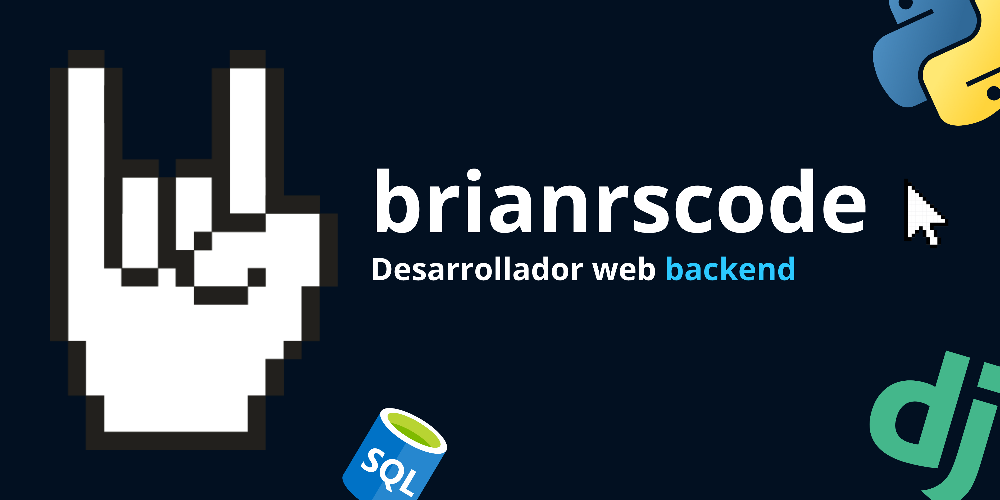

<!-- -->
<!-- Banner -->

  

<!-- Typing -->

  
  <!-- &hearts ++;Explorando+nuevas+tecnologías🤖; -->

<!-- ----------------------------------- Sobre mí ----------------------------------- 😀 -->
## <picture></picture> **Sobre mí.**

Soy desarrollador web enfocado principalmente en backend y en el ecosistema de Python.

Actualmente trabajo y aprendo alrededor de tecnologías como Django, FastAPI, SQL y Linux, mientras continúo mejorando mis conocimientos sobre arquitectura de aplicaciones, APIs y bases de datos.

Me interesa construir software práctico, entender cómo funcionan las herramientas que utilizo y seguir mejorando tanto mis fundamentos como mis prácticas de desarrollo.

 

<!-- ----------------------------------- Áreas de interés ----------------------------------- -->
## <picture></picture> **Áreas de interés.**
- 💻 Desarrollo web
- 🌐 APIs y aplicaciones web
- 🗄️ Bases de datos y SQL
- 🐧 Linux y herramientas de desarrollo
- 🏗️ Arquitectura y diseño de software

<!-- ## 🛠 -------------------- Lenguajes Librerías y Herramientas -------------------- -->
## <b> Tecnologías</b>

  <a href="https://github.com/LelouchFR/skill-icons">
     
     
    
  </a>

<!-- ----------------------------------- Estadísticas de GitHub ----------------------------------- -->
## 📊 GitHub

  
  

## 📫 Contacto

Estoy abierto a colaborar en proyectos interesantes y continuar aprendiendo junto a otros desarrolladores.

